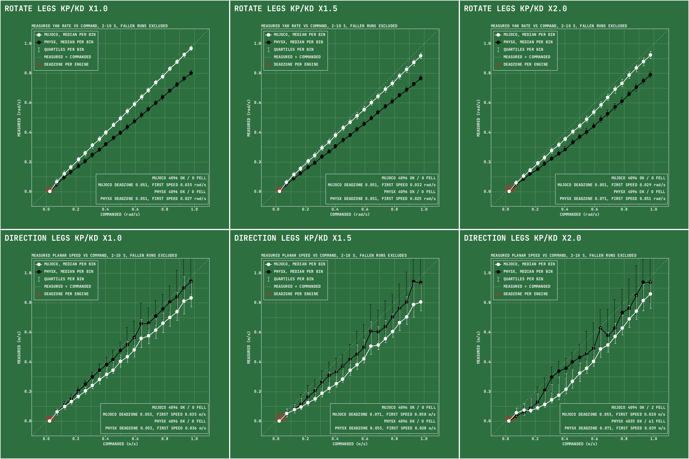

# teleop-walking-benchmark

https://github.com/user-attachments/assets/2afc89b9-3a05-4dab-a161-80ad3c0405ad

Forty-three open-source Unitree G1 walking policies behind one C++ interface,
scored on one tour in MuJoCo and PhysX.
[Blog post](https://rhoyn.com/stable-walk?utm_source=github)

## The task

Three minutes, eighteen waypoints ten seconds apart, 50 Hz control over a 2 ms
step. A crane holds a shared stance three seconds, then releases. Each segment
lands a punch:
random joint and direction, 0.08 s, up to 500 N — the ceiling ramps from a
third of that at the start to the full 500 N by the 120th second, and each
punch draws half to all of it. The score is recovery, not tracking. A policy
owns the fifteen leg and waist joints; the fourteen arm joints random-walk under
the harness, never still, never borrowable for balance. The best finishes most
runs, none all.

## Unified benchmark interface

Every policy and every physics engine sits behind the same CUDA interface, so
the harness runs the whole field batched on the GPU instead of one process per
policy per run id. That is what makes 125,952 runs cheap enough to be a
benchmark rather than a demo. Both engines step on the GPU: PhysX natively,
MuJoCo through [MuJoCo Warp](https://github.com/google-deepmind/mujoco_warp).

## Running

```sh
./download_export_onnx.sh && make && make capture
./run.sh --policy gr00t_wbc_h074_p000 --engine physx --runids 0-255
./benchmark.sh          # whole field, both engines
./benchmark.sh --benchmark all   # punch tour, then rotate, then direction
```

Batches write `results/punches_gainx<G>/p<NN>.<policy>.<engine>.csv`, round
<NN> of the punch tour (`r<NN>` and `d<NN>` in `rotate_gainx<G>/` and
`direction_gainx<G>/`), one folder per leg gain (1.0, 1.5, 2.0: the policy's
leg kp and kd scaled); `./build/table` renders the table, problems land in
`benchmark.log`. Policies are TensorRT plans cached in `build/trt/`.

MuJoCo Warp has no C API, so `make capture` records one substep as a CUDA graph
into `build/mjwarp/` and `--engine mujoco` replays it from C++ with no Python at
run time. It will not start without that capture, and the capture fixes the
fleet size — re-record when the model or `--runs` changes:
`make capture MJWARP_NWORLD=256`.

## Results

125,952 runs — both engines, in rounds of 512 run ids. A run id names one whole
task. A policy earns depth by tier: tier A, the thirteen rows that complete at
least half their runs averaged over the two engines, ran five rounds, 2560 run
ids; tier B ran one, since a policy that falls most of the time needs no fourth
decimal place. The `runs` column carries each row's own count, so no row is read
against a total it never had.

Rows are ordered by mean survival over both engines. Errors are means over
targets reached; the walk energy, vibration and stomp energy columns are means
over completed runs, and an engine's cell is blank when fewer than a fifth of
its runs qualify. Both engines step on the GPU: MuJoCo through MuJoCo Warp,
PhysX through its GPU solver.

Stomp energy is how hard a policy puts its feet down: the work a foot does
on the floor per touchdown, in joules — the ankle force integrated against
the foot's downward speed over each stance, every 2 ms substep, averaged over
the touchdowns of completed runs. Per-segment values are in each CSV as
`s<N>_stomp_j`.

| `--policy` | mean<br>survival<br>sec<br>mujoco<br>physx | compl-<br>eted<br>percent<br>mujoco<br>physx | runs | pos<br>err<br>cm<br>mujoco<br>physx | yaw<br>err<br>deg<br>mujoco<br>physx | walk<br>energy<br>KJ<br>mujoco<br>physx | walk<br>vibrations<br>mujoco<br>physx | stomp<br>energy<br>J<br>mujoco<br>physx |
|---:|---:|---:|---:|---:|---:|---:|---:|---:|
| `gr00t_wbc`<br>`h070_p000` | **172/173** | 83/84 | 2560 | 14/27 | 5/6 | 7.9/9.2 | 1.1/1.7 | 1.2/0.8 |
| `htd_wbc`<br>`h066_p012` | **174/171** | 86/81 | 2560 | 7/15 | 10/9 | 6.1/13.1 | 1.4/4.0 | 1.6/0.9 |
| `htd_wbc`<br>`h066_p000` | **173/169** | 84/79 | 2560 | 8/19 | 10/6 | 6.1/15.5 | 1.5/4.7 | 1.6/0.8 |
| `htd_wbc`<br>`h070_p000` | **172/170** | 83/79 | 2560 | 8/12 | 14/12 | 6.0/13.1 | 1.4/3.7 | 1.7/1.2 |
| `gr00t_wbc`<br>`h066_p012` | **174/166** | 88/74 | 2560 | 25/122 | 17/12 | 7.6/9.8 | 0.9/1.7 | 1.0/0.3 |
| `htd_wbc`<br>`h074_p000` | **170/169** | 79/77 | 2560 | 12/10 | 21/13 | 6.0/13.7 | 1.4/3.7 | 1.8/1.7 |
| `gr00t_wbc`<br>`h066_p000` | **174/164** | 88/73 | 2560 | 29/147 | 22/14 | 7.3/9.9 | 0.9/1.8 | 1.1/0.4 |
| `gr00t_wbc`<br>`h074_p000` | **168/170** | 74/77 | 2560 | 11/18 | 4/4 | 8.6/10.2 | 1.2/1.6 | 1.9/1.5 |
| `morphmimic`<br>`gr00twbcplnr` | **158/168** | 68/81 | 2560 | 89/75 | 5/4 | 11.8/14.2 | 1.6/2.0 | 1.0/2.2 |
| `morphmimic`<br>`sonicplnr` | **152/170** | 62/84 | 2560 | 59/41 | 10/10 | 11.1/14.1 | 1.8/2.3 | 1.8/3.6 |
| `homie` | **155/156** | 54/54 | 2560 | 16/16 | 17/20 | 11.9/11.3 | 1.8/2.1 | 3.0/2.8 |
| `wbc_agile`<br>`velocity` | **149/159** | 48/63 | 2560 | 16/16 | 7/6 | 13.1/13.5 | 2.2/2.8 | 4.9/4.5 |
| `amo` | **151/154** | 54/57 | 2560 | 18/49 | 8/7 | 14.8/17.9 | 2.1/2.4 | 2.3/2.3 |
| `wbc_agile` | **145/133** | 38/25 | 512 | 18/33 | 8/10 | 8.1/10.3 | 1.3/1.9 | 3.3/3.2 |
| `zealot` | **133/117** | 27/15 | 512 | 71/168 | 46/62 | 46.1/- | 21.9/- | 1.3/- |
| `supermimic`<br>`rayzhao`<br>`gr00twbcplnr` | **126/122** | 41/36 | 512 | 325/260 | 27/29 | 17.8/22.1 | 2.5/3.1 | 1.6/3.3 |
| `supermimic`<br>`rayzhao`<br>`sonicplnr` | **122/121** | 37/38 | 512 | 210/179 | 25/27 | 17.9/24.0 | 2.6/3.5 | 1.9/4.5 |
| `supermimic`<br>`dyn`<br>`sonicplnr` | **112/122** | 24/31 | 512 | 265/299 | 23/23 | 19.8/27.2 | 2.9/3.7 | 1.9/4.9 |
| `supermimic`<br>`dyn`<br>`gr00twbcplnr` | **107/103** | 20/19 | 512 | 266/283 | 15/14 | 18.0/- | 2.5/- | 1.2/- |
| `mimic_lite`<br>`gr00twbcplnr` | **94/113** | 10/19 | 512 | 230/168 | 9/9 | -/- | -/- | -/- |
| `run_residual` | **101/102** | 6/9 | 512 | 1146/1174 | 14/13 | -/- | -/- | -/- |
| `sonic` | **118/81** | 24/5 | 512 | 75/89 | 13/17 | 14.6/- | 2.2/- | 2.9/- |
| `mimic_lite`<br>`sonicplnr` | **87/95** | 8/13 | 512 | 148/127 | 15/15 | -/- | -/- | -/- |
| `supermimic`<br>`panhainan`<br>`gr00twbcplnr` | **61/111** | 2/24 | 512 | 282/588 | 20/13 | -/39.3 | -/4.8 | -/5.7 |
| `supermimic`<br>`kangzejian`<br>`sonicplnr` | **82/80** | 16/16 | 512 | 132/129 | 39/37 | -/- | -/- | -/- |
| `supermimic`<br>`panhainan`<br>`sonicplnr` | **39/100** | 0/15 | 512 | 331/751 | 30/19 | -/- | -/- | -/- |
| `wty_cpp` | **71/68** | 1/1 | 512 | 28/33 | 22/22 | -/- | -/- | -/- |
| `falcon` | **70/58** | 0/0 | 512 | 48/58 | 15/16 | -/- | -/- | -/- |
| `openwbt` | **42/84** | 0/1 | 512 | 117/92 | 26/16 | -/- | -/- | -/- |
| `morphmimic`<br>`openwbtplnr` | **59/62** | 4/5 | 512 | 164/184 | 28/29 | -/- | -/- | -/- |
| `supermimic`<br>`rayzhao`<br>`openwbtplnr` | **59/61** | 2/2 | 512 | 354/320 | 43/44 | -/- | -/- | -/- |
| `asap` | **61/56** | 1/1 | 512 | 211/172 | 28/30 | -/- | -/- | -/- |
| `schoi` | **59/51** | 0/0 | 512 | 45/84 | 22/27 | -/- | -/- | -/- |
| `supermimic`<br>`dyn`<br>`openwbtplnr` | **52/54** | 1/1 | 512 | 336/370 | 29/28 | -/- | -/- | -/- |
| `robomimic` | **56/50** | 3/2 | 512 | 369/298 | 25/25 | -/- | -/- | -/- |
| `supermimic`<br>`kangzejian`<br>`gr00twbcplnr` | **54/50** | 10/7 | 512 | 199/204 | 31/32 | -/- | -/- | -/- |
| `rl_gym` | **29/70** | 0/1 | 512 | 156/75 | 38/16 | -/- | -/- | -/- |
| `supermimic`<br>`kyrieyoung`<br>`sonicplnr` | **50/46** | 1/1 | 512 | 385/357 | 42/41 | -/- | -/- | -/- |
| `supermimic`<br>`kyrieyoung`<br>`gr00twbcplnr` | **52/44** | 1/0 | 512 | 354/307 | 44/44 | -/- | -/- | -/- |
| `supermimic`<br>`panhainan`<br>`openwbtplnr` | **37/55** | 0/1 | 512 | 450/913 | 31/27 | -/- | -/- | -/- |
| `mimic_lite`<br>`openwbtplnr` | **43/47** | 0/1 | 512 | 195/180 | 20/22 | -/- | -/- | -/- |
| `supermimic`<br>`kangzejian`<br>`openwbtplnr` | **39/38** | 0/0 | 512 | 255/256 | 35/36 | -/- | -/- | -/- |
| `supermimic`<br>`kyrieyoung`<br>`openwbtplnr` | **38/35** | 0/0 | 512 | 498/468 | 47/47 | -/- | -/- | -/- |
| `rl_lab` | **40/34** | 0/0 | 512 | 64/77 | 71/72 | -/- | -/- | -/- |
| `supermimic`<br>`m5`<br>`gr00twbcplnr` | **36/38** | 0/0 | 512 | 497/494 | 33/33 | -/- | -/- | -/- |
| `supermimic`<br>`m5`<br>`sonicplnr` | **36/37** | 0/0 | 512 | 594/589 | 41/40 | -/- | -/- | -/- |
| `supermimic`<br>`breezewrf`<br>`sonicplnr` | **33/37** | 0/0 | 512 | 351/318 | 47/45 | -/- | -/- | -/- |
| `supermimic`<br>`breezewrf`<br>`openwbtplnr` | **32/36** | 0/0 | 512 | 356/412 | 50/51 | -/- | -/- | -/- |
| `supermimic`<br>`breezewrf`<br>`gr00twbcplnr` | **30/34** | 0/0 | 512 | 542/587 | 47/45 | -/- | -/- | -/- |
| `supermimic`<br>`m5`<br>`openwbtplnr` | **27/28** | 0/0 | 512 | 593/591 | 39/37 | -/- | -/- | -/- |
| `handoff` | **23/26** | 0/0 | 512 | 234/230 | 30/31 | -/- | -/- | -/- |
| `supermimic`<br>`omegai`<br>`gr00twbcplnr` | **22/25** | 0/0 | 512 | 748/770 | 31/32 | -/- | -/- | -/- |
| `supermimic`<br>`omegai`<br>`sonicplnr` | **19/19** | 0/0 | 512 | 936/988 | 49/47 | -/- | -/- | -/- |
| `supermimic`<br>`omegai`<br>`openwbtplnr` | **19/18** | 0/0 | 512 | 1216/1121 | 42/45 | -/- | -/- | -/- |
| `bfm_zero` | **16/12** | 0/0 | 512 | 487/514 | 69/86 | -/- | -/- | -/- |
| `josabb`\* | **11/11** | 0/0 | 512 | 144/172 | 83/86 | -/- | -/- | -/- |
| `huru`\* | **8/8** | 0/0 | 512 | 201/199 | 69/77 | -/- | -/- | -/- |
| `sunny`\* | **8/8** | 0/0 | 512 | 203/240 | 76/75 | -/- | -/- | -/- |
| `dm_march` | **9/5** | 0/0 | 512 | 164/177 | 90/91 | -/- | -/- | -/- |
| `dm_agile` | **9/4** | 1/0 | 512 | 57/53 | 88/88 | -/- | -/- | -/- |
| `holosoma` | **6/6** | 0/0 | 512 | 79/100 | 45/60 | -/- | -/- | -/- |
| `rl_mjlab` | **6/5** | 0/0 | 512 | 294/283 | 73/78 | -/- | -/- | -/- |
| `legged_rl_lab` | **4/4** | 0/0 | 512 | 224/227 | 85/86 | -/- | -/- | -/- |
| `mturan33`\* | **3/4** | 0/0 | 512 | 224/246 | 89/87 | -/- | -/- | -/- |
| `wcompton` | **3/2** | 0/0 | 512 | 129/142 | 55/58 | -/- | -/- | -/- |
| `g1_gym` | **2/2** | 0/0 | 512 | 112/110 | 87/92 | -/- | -/- | -/- |
| `nanog1` | **2/2** | 0/0 | 512 | 83/90 | 58/60 | -/- | -/- | -/- |
| `clobot` | **2/2** | 0/0 | 512 | 130/125 | 84/80 | -/- | -/- | -/- |
| `stepdown` | **2/2** | 0/0 | 512 | 93/92 | 67/61 | -/- | -/- | -/- |
| ~~`handoff`<br>`with_arms`~~\*\* | ~~**139/140**~~ | ~~35/36~~ | ~~512~~ | ~~13/15~~ | ~~8/9~~ | ~~7.8/12.7~~ | ~~1.3/2.5~~ | ~~3.4/3.9~~ |
| ~~`clobot`<br>`with_arms`~~\*\* | ~~**87/73**~~ | ~~3/1~~ | ~~512~~ | ~~23/25~~ | ~~14/16~~ | ~~-/-~~ | ~~-/-~~ | ~~-/-~~ |

`gr00t_wbc` is HOMIE v2, not an independent policy family. Its author
developed it at GEAR as the successor to `homie`, with substantial
optimisations across the stack, so `gr00t_wbc` and `homie` are the same lineage
rather than separate entries. Confirmed by @Elgce in InternRobotics/OpenHomie#23.

\* Reads the base linear velocity straight from the simulator. No real robot
has that sensor, so the row is ranked but the policy is not deployable as
shipped.

\*\* Unranked, because it is the same policy given all 29 joints instead of 15.

### Trackers and their reference

`mimic_lite` (MimicLite-ROA), `morphmimic` and the eight `supermimic`
reproductions are motion trackers: they follow a reference motion, not a
velocity command, and none ships a planner of its own (MorphMimic's release
plays recorded clips). The harness makes the reference from the same velocity
command three ways, named by suffix. `_sonicplnr` uses `sonic`'s planner.
`_openwbtplnr` and `_gr00twbcplnr` give each robot a private MuJoCo G1 driven by
`openwbt` or `gr00t_wbc_h074_p000` that walks 15 ticks ahead; its pelvis pose
and joints become the reference. That ghost is never punched or scored, and a
one-sided spring under its pelvis keeps it from falling. Its command follows the
same rule as `openwbt` and `gr00t_wbc` on their own: limited and ramped in the
tour, passed through untouched in rotate and direction.

`morphmimic_sonicplnr` is the tracker that holds up: 62/84 completed, level with
the best PhysX completion of any row, though its position error of 59/41 cm is
well above the 7-27 cm of `gr00t_wbc` at 0.70-0.74 m and of `htd_wbc`.
The GR00T WBC ghost matches the planner on survival for `morphmimic` and
`supermimic_rayzhao`, gains for `mimic_lite` and `supermimic_panhainan`, and
loses some for `supermimic_dyn` and a third for `supermimic_kangzejian`. It
puts the feet down more softly (`morphmimic` stomp 1.8/3.6 → 1.0/2.2 J) and
halves `morphmimic`'s yaw error to 5/4°, at the cost of position error, 89/75 cm
for `morphmimic_gr00twbcplnr`. The OpenWBT ghost costs about half the survival
of every tracker that walks. On small commands both ghosts make `morphmimic`,
`mimic_lite` and `supermimic_dyn` far more precise than the planner does (see
below), the GR00T WBC ghost most, 96/96/103% error → 54/78/45%; neither
helps `supermimic_rayzhao`.

### Speed limits and the clock

Each waypoint gets 10 s. In the tour `sonic`, the trackers and their ghosts are
commanded at most 0.3 m/s (0.2 m/s sideways for the planner) and 0.5 rad/s, and
`openwbt`, `gr00t_wbc` and `htd_wbc` the same with a 1 s ramp up and down.
Each waypoint opens with a punch, and turning to a heading up to 180° away takes
up to 6.3 s at 0.5 rad/s, plus a second or two recovering from the punch. At
the 5 s an earlier version of the tour gave, even an ideal robot missed a fifth
to a third of the headings, so the yaw column of these rows carried a floor of
roughly 7-35° set by the clock rather than the policy: `gr00t_wbc` and
`htd_wbc` showed 14-43°. At 10 s the floor is about 3-5° and 10 cm, the
reached radius, and the same rows show 4-22°, `gr00t_wbc_h070_p000` 22/31° →
5/6°.

The longer tour also spends a full minute at the 500 N ceiling rather than half
a minute. The velocity policies complete as often as they did over ninety
seconds, `gr00t_wbc_h070_p000` 84/81 → 83/84 and `homie` 55/52 → 54/54; the
trackers lose ground as their position error builds,
`morphmimic_sonicplnr` 71/92 → 62/84 and `supermimic_rayzhao_sonicplnr` 57/58 →
37/38, which takes it and its GR00T WBC ghost row out of tier A.

### Leg gains

Every policy was rerun with the kp and kd of its twelve leg joints scaled by
1.5 and by 2.0, waist and arms untouched, on 1024 run ids per engine:
`results/punches_gainx1.5/` and `results/punches_gainx2.0/` next to the
native-gain `results/punches_gainx1.0/` above. Compared over the run ids all
three share, 0-511 on both engines, stiffer legs make 27 of the 71 rows worse
at x1.5 and 43 at x2.0.

| `--policy` | mean survival sec<br>x1.0 / x1.5 / x2.0 | x1.5<br>diff | x2.0<br>diff | walk energy KJ<br>x1.0 / x1.5 / x2.0 | walk vibrations<br>x1.0 / x1.5 / x2.0 |
|---:|---:|---:|---:|---:|---:|
| `openwbt` | 63 / 5 / 3 | -92.3% | -95.8% | - / - / - | - / - / - |
| `rl_gym` | 49 / 12 / 4 | -76.2% | -91.0% | - / - / - | - / - / - |
| `schoi` | 55 / 21 / 4 | -62.6% | -92.7% | - / - / - | - / - / - |
| `rl_lab` | 37 / 25 / 17 | -32.2% | -55.1% | - / - / - | - / - / - |
| `wbc_agile` | 139 / 104 / 54 | -25.1% | -61.5% | 9.0 / - / - | 1.5 / - / - |
| `wty_cpp` | 69 / 57 / 33 | -17.6% | -52.5% | - / - / - | - / - / - |
| `wbc_agile`<br>`velocity` | 154 / 131 / 80 | -14.8% | -48.0% | 14.1 / 28.5 / - | 2.5 / 4.2 / - |
| `sonic` | 100 / 83 / 56 | -16.6% | -43.9% | - / - / - | - / - / - |
| `handoff`<br>`with_arms` | 140 / 125 / 71 | -10.2% | -48.9% | 10.3 / 15.1 / - | 1.9 / 2.4 / - |
| `legged_rl_lab` | 4 / 3 / 3 | -17.9% | -26.0% | - / - / - | - / - / - |
| `run_residual` | 102 / 99 / 60 | -2.9% | -40.8% | - / - / - | - / - / - |
| `asap` | 58 / 54 / 38 | -6.9% | -35.4% | - / - / - | - / - / - |
| `falcon` | 64 / 64 / 40 | +0.4% | -37.5% | - / - / - | - / - / - |
| `handoff` | 24 / 25 / 17 | +3.5% | -31.2% | - / - / - | - / - / - |
| `g1_gym` | 2 / 2 / 2 | -6.5% | -14.8% | - / - / - | - / - / - |
| `bfm_zero` | 14 / 14 / 11 | -2.7% | -18.1% | - / - / - | - / - / - |
| `gr00t_wbc`<br>`h070_p000` | 173 / 167 / 151 | -3.1% | -12.4% | 8.7 / 13.9 / 23.5 | 1.3 / 1.7 / 3.0 |
| `mturan33` | 4 / 3 / 3 | -6.0% | -8.4% | - / - / - | - / - / - |
| `supermimic`<br>`kyrieyoung`<br>`openwbtplnr` | 37 / 36 / 33 | -3.3% | -9.8% | - / - / - | - / - / - |
| `supermimic`<br>`breezewrf`<br>`openwbtplnr` | 34 / 34 / 29 | +1.0% | -13.8% | - / - / - | - / - / - |
| `gr00t_wbc`<br>`h066_p012` | 170 / 168 / 153 | -1.1% | -10.1% | 8.7 / 12.8 / 21.7 | 1.2 / 1.6 / 2.5 |
| `gr00t_wbc`<br>`h074_p000` | 168 / 167 / 152 | -1.0% | -9.4% | 9.4 / 13.3 / 22.0 | 1.4 / 1.8 / 3.0 |
| `rl_mjlab` | 6 / 6 / 5 | -0.3% | -9.9% | - / - / - | - / - / - |
| `supermimic`<br>`kyrieyoung`<br>`sonicplnr` | 48 / 48 / 43 | +0.0% | -10.0% | - / - / - | - / - / - |
| `homie` | 156 / 153 / 144 | -1.9% | -8.0% | 11.7 / 17.5 / 27.5 | 1.9 / 2.3 / 3.1 |
| `htd_wbc`<br>`h074_p000` | 170 / 167 / 156 | -1.6% | -8.2% | 10.2 / 12.7 / 19.0 | 2.6 / 3.0 / 4.1 |
| `supermimic`<br>`breezewrf`<br>`gr00twbcplnr` | 32 / 35 / 26 | +9.8% | -18.2% | - / - / - | - / - / - |
| `gr00t_wbc`<br>`h066_p000` | 168 / 169 / 153 | +0.7% | -8.9% | 8.6 / 12.4 / 21.3 | 1.2 / 1.6 / 2.5 |
| `supermimic`<br>`breezewrf`<br>`sonicplnr` | 35 / 38 / 30 | +7.6% | -15.5% | - / - / - | - / - / - |
| `supermimic`<br>`rayzhao`<br>`openwbtplnr` | 60 / 58 / 57 | -2.4% | -4.0% | - / - / - | - / - / - |
| `htd_wbc`<br>`h070_p000` | 171 / 169 / 161 | -0.9% | -5.4% | 11.2 / 14.2 / 24.2 | 2.9 / 3.3 / 5.0 |
| `robomimic` | 53 / 52 / 51 | -2.3% | -4.0% | - / - / - | - / - / - |
| `wcompton` | 2 / 2 / 2 | +2.3% | -8.4% | - / - / - | - / - / - |
| `htd_wbc`<br>`h066_p012` | 171 / 170 / 162 | -0.7% | -5.3% | 12.5 / 18.1 / 32.2 | 3.4 / 4.2 / 6.3 |
| `htd_wbc`<br>`h066_p000` | 170 / 169 / 164 | -0.7% | -3.1% | 12.1 / 17.5 / 28.3 | 3.3 / 4.0 / 5.7 |
| `supermimic`<br>`kyrieyoung`<br>`gr00twbcplnr` | 48 / 49 / 46 | +2.9% | -4.6% | - / - / - | - / - / - |
| `mimic_lite`<br>`gr00twbcplnr` | 104 / 105 / 101 | +1.0% | -2.4% | - / - / - | - / - / - |
| `morphmimic`<br>`sonicplnr` | 160 / 165 / 155 | +3.1% | -3.5% | 12.9 / 13.9 / 19.9 | 2.1 / 2.2 / 2.9 |
| `mimic_lite`<br>`openwbtplnr` | 45 / 46 / 45 | +0.9% | -0.5% | - / - / - | - / - / - |
| `morphmimic`<br>`gr00twbcplnr` | 163 / 168 / 160 | +3.0% | -1.7% | 13.1 / 16.1 / 23.2 | 1.8 / 2.4 / 3.4 |
| `supermimic`<br>`kangzejian`<br>`openwbtplnr` | 38 / 38 / 39 | +0.6% | +1.6% | - / - / - | - / - / - |
| `morphmimic`<br>`openwbtplnr` | 60 / 62 / 61 | +2.3% | +0.4% | - / - / - | - / - / - |
| `amo` | 152 / 154 / 156 | +1.4% | +2.4% | 16.4 / 21.1 / 28.1 | 2.2 / 2.6 / 3.1 |
| `supermimic`<br>`panhainan`<br>`openwbtplnr` | 46 / 49 / 47 | +5.1% | +0.8% | - / - / - | - / - / - |
| `supermimic`<br>`omegai`<br>`openwbtplnr` | 19 / 20 / 19 | +6.2% | -0.2% | - / - / - | - / - / - |
| `supermimic`<br>`m5`<br>`sonicplnr` | 37 / 41 / 34 | +13.1% | -6.1% | - / - / - | - / - / - |
| `clobot`<br>`with_arms` | 80 / 85 / 81 | +6.4% | +1.4% | - / - / - | - / - / - |
| `supermimic`<br>`rayzhao`<br>`gr00twbcplnr` | 124 / 131 / 127 | +6.3% | +2.3% | 19.8 / 26.9 / 36.3 | 2.8 / 3.6 / 4.6 |
| `supermimic`<br>`omegai`<br>`sonicplnr` | 19 / 20 / 19 | +8.0% | +2.8% | - / - / - | - / - / - |
| `supermimic`<br>`rayzhao`<br>`sonicplnr` | 121 / 129 / 126 | +6.6% | +4.4% | 21.0 / 25.9 / 40.1 | 3.0 / 3.6 / 5.0 |
| `clobot` | 2 / 2 / 2 | +4.8% | +6.4% | - / - / - | - / - / - |
| `supermimic`<br>`kangzejian`<br>`sonicplnr` | 81 / 88 / 83 | +9.4% | +2.9% | - / - / - | - / - / - |
| `holosoma` | 6 / 7 / 7 | +5.7% | +7.1% | - / - / - | - / - / - |
| `mimic_lite`<br>`sonicplnr` | 91 / 98 / 97 | +8.0% | +6.4% | - / - / - | - / - / - |
| `supermimic`<br>`omegai`<br>`gr00twbcplnr` | 23 / 26 / 24 | +12.0% | +3.4% | - / - / - | - / - / - |
| `supermimic`<br>`m5`<br>`openwbtplnr` | 28 / 32 / 28 | +16.1% | -0.3% | - / - / - | - / - / - |
| `zealot` | 125 / 142 / 130 | +13.5% | +3.8% | 45.1 / 125.2 / 200.6 | 18.4 / 29.1 / 36.9 |
| `supermimic`<br>`dyn`<br>`openwbtplnr` | 53 / 58 / 58 | +8.6% | +9.1% | - / - / - | - / - / - |
| `supermimic`<br>`panhainan`<br>`sonicplnr` | 70 / 82 / 73 | +17.2% | +4.2% | - / - / - | - / - / - |
| `supermimic`<br>`m5`<br>`gr00twbcplnr` | 37 / 46 / 39 | +24.2% | +7.3% | - / - / - | - / - / - |
| `supermimic`<br>`dyn`<br>`sonicplnr` | 117 / 142 / 137 | +21.9% | +17.5% | 23.9 / 27.2 / 39.7 | 3.3 / 3.5 / 4.6 |
| `dm_agile` | 6 / 7 / 8 | +5.8% | +34.4% | - / - / - | - / - / - |
| `supermimic`<br>`panhainan`<br>`gr00twbcplnr` | 86 / 107 / 105 | +25.0% | +22.2% | - / - / - | - / - / - |
| `stepdown` | 2 / 2 / 2 | +22.6% | +29.9% | - / - / - | - / - / - |
| `supermimic`<br>`kangzejian`<br>`gr00twbcplnr` | 52 / 66 / 69 | +26.5% | +31.6% | - / - / - | - / - / - |
| `huru` | 8 / 10 / 11 | +28.0% | +30.4% | - / - / - | - / - / - |
| `nanog1` | 2 / 3 / 3 | +25.8% | +34.6% | - / - / - | - / - / - |
| `supermimic`<br>`dyn`<br>`gr00twbcplnr` | 105 / 142 / 138 | +34.5% | +31.3% | - / 24.2 / 32.2 | - / 3.1 / 3.9 |
| `josabb` | 11 / 14 / 15 | +29.0% | +39.3% | - / - / - | - / - / - |
| `sunny` | 8 / 11 / 13 | +35.5% | +58.2% | - / - / - | - / - / - |
| `dm_march` | 7 / 11 / 11 | +60.5% | +55.7% | - / - / - | - / - / - |

Energy and vibrations are means over completed runs of both engines, `-`
where fewer than a fifth of a row's runs complete.

Stiffer legs cost the `gr00t_wbc`, `htd_wbc` and `homie` rows up to three
percent of their survival at x1.5 and three to twelve percent at x2.0;
`wbc_agile_velocity` loses fifteen and forty-eight percent, and `openwbt`,
`rl_gym` and `schoi` lose most of theirs already at x1.5. The trackers are the
exception: both `morphmimic` rows gain three percent at x1.5 and give back two
to four at x2.0, and most `supermimic` rows gain at x1.5,
`supermimic_dyn_gr00twbcplnr` by thirty-five percent, alongside `amo`, `zealot`,
`mimic_lite_sonicplnr` and `clobot` with arms. Several of the large gains at
the bottom of the table are a few seconds on policies that fall within the first
quarter-minute either way. Each network learned the dynamics of the gains it was
trained with, so scaling them moves most policies outside what they know, and
the legs also work harder for it: every row that completes enough runs spends
more energy and vibrates more, `gr00t_wbc` h066_p012 going from 8.7 to 12.8 to
21.7 kJ.

TL;DR: increasing the default leg gains makes most velocity policies less
stable; the motion trackers tolerate it or gain a little.

### Why two policies appear four times each

`gr00t_wbc` and `htd_wbc` are each one checkpoint under four commanded
postures: `h` is torso height in metres, `p` torso pitch in radians. Every row
owns the same fifteen joints and takes the same commands as any other entry, so
every row is ranked. `gr00t_wbc_h074_p000` and `htd_wbc_h070_p000` are
the postures their authors call canonical.

Commanded height is the only thing that moves the score, and for `gr00t_wbc` it
buys completion by giving up tracking: 0.74 → 0.70 m is worth nine points of
completion in MuJoCo and seven in PhysX for three and nine centimetres of
position error; 0.66 m is another five points in MuJoCo for eleven to fifteen
more centimetres, while in PhysX it gives ten or eleven points back and the
error grows four- to fivefold, 27 → 122-147 cm. `htd_wbc` pays nothing —
0.74 → 0.70 m gains two to four points and its MuJoCo error falls from 12 to
8 cm, 0.66 m adds one to three more at 7-8 cm in MuJoCo, the lowest in the
table, though PhysX drifts from 10-12 to 15-19 cm. Commanded pitch adds at most
two points in either engine.

A wider sweep over `gr00t_wbc`'s walk/balance switch found it inert, so it is
not reported. Read every one of these rows against the error column as well as
the completion column.

`htd_wbc` is the whole-body controller of
[Humanoid Touch Dream (HTD)](https://humanoid-touch-dream.github.io/), from
[IsaacLab-Decoupled-WBC](https://github.com/chrisyrniu/IsaacLab-Decoupled-WBC);
it was listed as `decoupled_wbc` before. Its sweep was suggested by @chrisyrniu in
https://github.com/chrisyrniu/IsaacLab-Decoupled-WBC/issues/1#issuecomment-5596278961

### What a low score means

This benchmark scores a **walking policy that controls the lower body while the
upper body is driven externally**. The 15 leg and waist joints belong to the
policy; the 14 arm joints random-walk under the harness for the whole run.

Several policies score badly because they were trained to swing their arms to
keep balance, and that is not available to them here — the arms are assumed to
belong to a separate policy. **A low score is therefore not always a statement
that the policy is bad.** It often means the policy was never built for
lower-body balance under external upper-body control.

## Commanded vs measured movement

<!-- cmd_vs_real_movements:begin -->
Each run holds one command for 10 s, with no punches: a yaw rate in `--mode rotate`, a planar velocity in `--mode direction`, both drawn uniformly per run id up to 1 rad/s and 1 m/s. `./benchmark.sh --benchmark rotate|direction` runs every policy at legs KP/KD x1.0, x1.5 and x2.0 for 4096 run ids each into `results/<mode>_gainx<G>/`, and `build/cmd_vs_real_movements` charts measured against commanded speed into `results/cmd_vs_real_movements/`. Precision is scored on small commands, 0.05 to 0.15 m/s or rad/s, by movement along the command, both engines pooled, at the first accepted gain (x1.0, else x1.5, else x2.0). Error is the median distance between measured and commanded velocity relative to the command, walk and turn averaged (in rotate the planar drift counts as error): 0% is perfect, 100% is what standing still scores, above 100% the robot moves the wrong way. Right way is the share of runs moving at least 0.025 along the command; delivered is the median fraction of the command achieved along it; drift at zero is the median planar speed for direction commands under 0.02 m/s. Rows are ordered by error.

Policies are listed when their legs KP/KD x1.0 runs complete > 95% on average and at least one gain completes > 99% in rotate and > 95% in direction.

| # | policy | legs<br>KP/KD | error | walk:<br>right<br>way | walk:<br>delivered | drift<br>at zero m/s<br>MuJoCo / PhysX | turn:<br>right<br>way | turn:<br>delivered |
|---:|---|---:|---:|---:|---:|---:|---:|---:|
| 0 | [`gr00t_wbc`<br>`h074_p000`](results/cmd_vs_real_movements/000_gr00t_wbc_h074_p000.png) | x1.0 | 37% | 97% | 0.85 | 0.001 / 0.002 | 99% | 0.90 |
| 1 | [`supermimic`<br>`dyn`<br>`gr00twbcplnr`](results/cmd_vs_real_movements/001_supermimic_dyn_gr00twbcplnr.png) | x1.0 | 45% | 88% | 0.71 | 0.007 / 0.007 | 98% | 1.00 |
| 2 | [`morphmimic`<br>`gr00twbcplnr`](results/cmd_vs_real_movements/002_morphmimic_gr00twbcplnr.png) | x1.0 | 54% | 61% | 0.39 | 0.006 / 0.005 | 100% | 0.99 |
| 3 | [`openwbt`](results/cmd_vs_real_movements/003_openwbt.png) | x1.0 | 62% | 90% | 0.79 | 0.042 / 0.053 | 99% | 0.75 |
| 4 | [`morphmimic`<br>`openwbtplnr`](results/cmd_vs_real_movements/004_morphmimic_openwbtplnr.png) | x1.0 | 63% | 69% | 0.49 | 0.023 / 0.050 | 99% | 0.78 |
| 5 | [`gr00t_wbc`<br>`h070_p000`](results/cmd_vs_real_movements/005_gr00t_wbc_h070_p000.png) | x1.0 | 65% | 80% | 0.58 | 0.001 / 0.002 | 86% | 0.59 |
| 6 | [`mimic_lite`<br>`openwbtplnr`](results/cmd_vs_real_movements/006_mimic_lite_openwbtplnr.png) | x1.0 | 67% | 42% | 0.18 | 0.013 / 0.008 | 99% | 0.80 |
| 7 | [`supermimic`<br>`dyn`<br>`openwbtplnr`](results/cmd_vs_real_movements/007_supermimic_dyn_openwbtplnr.png) | x1.0 | 68% | 85% | 0.75 | 0.042 / 0.050 | 97% | 0.76 |
| 8 | [`gr00t_wbc`<br>`h066_p012`](results/cmd_vs_real_movements/008_gr00t_wbc_h066_p012.png) | x1.5 | 69% | 85% | 0.53 | 0.001 / 0.001 | 83% | 0.60 |
| 9 | [`supermimic`<br>`panhainan`<br>`gr00twbcplnr`](results/cmd_vs_real_movements/009_supermimic_panhainan_gr00twbcplnr.png) | x1.0 | 70% | 41% | 0.15 | 0.013 / 0.023 | 99% | 0.98 |
| 10 | [`wbc_agile`<br>`velocity`](results/cmd_vs_real_movements/010_wbc_agile_velocity.png) | x1.0 | 75% | 11% | 0.02 | 0.002 / 0.001 | 69% | 0.54 |
| 11 | [`gr00t_wbc`<br>`h066_p000`](results/cmd_vs_real_movements/011_gr00t_wbc_h066_p000.png) | x1.5 | 77% | 77% | 0.53 | 0.001 / 0.001 | 81% | 0.59 |
| 12 | [`mimic_lite`<br>`gr00twbcplnr`](results/cmd_vs_real_movements/012_mimic_lite_gr00twbcplnr.png) | x1.0 | 78% | 41% | 0.09 | 0.021 / 0.019 | 100% | 1.05 |
| 13 | [`zealot`](results/cmd_vs_real_movements/013_zealot.png) | x1.0 | 85% | 50% | 0.36 | 0.011 / 0.001 | 21% | 0.09 |
| 14 | [`wbc_agile`](results/cmd_vs_real_movements/014_wbc_agile.png) | x1.0 | 88% | 37% | 0.11 | 0.003 / 0.003 | 16% | 0.17 |
| 15 | [`sonic`](results/cmd_vs_real_movements/015_sonic.png) | x1.0 | 93% | 4% | 0.01 | 0.006 / 0.007 | 44% | 0.22 |
| 16 | [`mimic_lite`<br>`sonicplnr`](results/cmd_vs_real_movements/016_mimic_lite_sonicplnr.png) | x1.0 | 96% | 11% | 0.01 | 0.008 / 0.005 | 49% | 0.27 |
| 17 | [`morphmimic`<br>`sonicplnr`](results/cmd_vs_real_movements/017_morphmimic_sonicplnr.png) | x1.0 | 96% | 18% | 0.02 | 0.006 / 0.013 | 39% | 0.18 |
| 18 | [`clobot`<br>`with_arms`](results/cmd_vs_real_movements/018_clobot_with_arms.png) | x1.0 | 97% | 17% | 0.00 | 0.001 / 0.001 | 28% | 0.07 |
| 19 | [`htd_wbc`<br>`h070_p000`](results/cmd_vs_real_movements/019_htd_wbc_h070_p000.png) | x1.0 | 99% | 26% | 0.01 | 0.001 / 0.010 | 24% | 0.03 |
| 20 | [`handoff`<br>`with_arms`](results/cmd_vs_real_movements/020_handoff_with_arms.png) | x1.0 | 99% | 48% | 0.01 | 0.000 / 0.000 | 51% | 0.52 |
| 21 | [`htd_wbc`<br>`h074_p000`](results/cmd_vs_real_movements/021_htd_wbc_h074_p000.png) | x1.0 | 100% | 11% | 0.00 | 0.001 / 0.001 | 1% | 0.01 |
| 22 | [`homie`](results/cmd_vs_real_movements/022_homie.png) | x1.0 | 100% | 14% | 0.00 | 0.001 / 0.001 | 0% | 0.01 |
| 23 | [`rl_lab`](results/cmd_vs_real_movements/023_rl_lab.png) | x1.0 | 100% | 24% | 0.01 | 0.001 / 0.002 | 0% | 0.01 |
| 24 | [`htd_wbc`<br>`h066_p012`](results/cmd_vs_real_movements/024_htd_wbc_h066_p012.png) | x1.0 | 100% | 29% | 0.00 | 0.000 / 0.124 | 25% | 0.02 |
| 25 | [`amo`](results/cmd_vs_real_movements/025_amo.png) | x1.0 | 100% | 44% | 0.05 | 0.002 / 0.005 | 77% | 1.07 |
| 26 | [`robomimic`](results/cmd_vs_real_movements/026_robomimic.png) | x1.0 | 101% | 13% | 0.00 | 0.004 / 0.004 | 20% | 0.08 |
| 27 | [`htd_wbc`<br>`h066_p000`](results/cmd_vs_real_movements/027_htd_wbc_h066_p000.png) | x1.0 | 101% | 32% | 0.00 | 0.001 / 0.153 | 27% | 0.01 |
| 28 | [`supermimic`<br>`dyn`<br>`sonicplnr`](results/cmd_vs_real_movements/028_supermimic_dyn_sonicplnr.png) | x1.0 | 103% | 41% | 0.12 | 0.013 / 0.023 | 44% | 0.20 |
| 29 | [`supermimic`<br>`rayzhao`<br>`openwbtplnr`](results/cmd_vs_real_movements/029_supermimic_rayzhao_openwbtplnr.png) | x1.0 | 105% | 67% | 0.48 | 0.049 / 0.062 | 75% | 0.65 |
| 30 | [`supermimic`<br>`rayzhao`<br>`sonicplnr`](results/cmd_vs_real_movements/030_supermimic_rayzhao_sonicplnr.png) | x1.0 | 106% | 29% | 0.05 | 0.027 / 0.033 | 42% | 0.17 |
| 31 | [`supermimic`<br>`rayzhao`<br>`gr00twbcplnr`](results/cmd_vs_real_movements/031_supermimic_rayzhao_gr00twbcplnr.png) | x1.0 | 111% | 49% | 0.24 | 0.078 / 0.073 | 75% | 0.76 |
| 32 | [`falcon`](results/cmd_vs_real_movements/032_falcon.png) | x1.0 | 135% | 69% | 0.82 | 0.132 / 0.112 | 100% | 0.95 |
| 33 | [`asap`](results/cmd_vs_real_movements/033_asap.png) | x1.0 | 172% | 69% | 0.75 | 0.129 / 0.117 | 66% | 0.52 |



`gr00t_wbc_h074_p000` ranks first at legs KP/KD x1.0, with 37% error on small commands. It moves the commanded way in 97% of small walking commands and 99% of small turns, delivers 85% and 90% of them, and drifts 0.001 / 0.002 m/s (MuJoCo / PhysX) when asked to stand still. In the punch tour above it survives 169 s on average, 8 of 71 (the best, `gr00t_wbc_h070_p000`, 173 s).

MuJoCo and PhysX differ in yaw-rate tracking by 0.036 on average (area between the engines' median curves at x1.0), from `morphmimic_openwbtplnr` closest to `htd_wbc_h066_p000` furthest:

| policy | gap |
|---|---:|
| `morphmimic`<br>`openwbtplnr` | 0.0006 |
| `mimic_lite`<br>`openwbtplnr` | 0.0008 |
| `supermimic`<br>`dyn`<br>`openwbtplnr` | 0.0010 |
| `supermimic`<br>`panhainan`<br>`gr00twbcplnr` | 0.0011 |
| `morphmimic`<br>`gr00twbcplnr` | 0.0013 |
| `mimic_lite`<br>`gr00twbcplnr` | 0.0018 |
| `supermimic`<br>`dyn`<br>`gr00twbcplnr` | 0.0023 |
| `supermimic`<br>`rayzhao`<br>`gr00twbcplnr` | 0.0027 |
| `amo` | 0.0048 |
| `supermimic`<br>`rayzhao`<br>`openwbtplnr` | 0.0058 |
| `sonic` | 0.0092 |
| `mimic_lite`<br>`sonicplnr` | 0.0203 |
| `handoff`<br>`with_arms` | 0.0206 |
| `asap` | 0.0218 |
| `zealot` | 0.0221 |
| `clobot`<br>`with_arms` | 0.0232 |
| `supermimic`<br>`rayzhao`<br>`sonicplnr` | 0.0264 |
| `wbc_agile`<br>`velocity` | 0.0269 |
| `homie` | 0.0320 |
| `openwbt` | 0.0341 |
| `wbc_agile` | 0.0369 |
| `supermimic`<br>`dyn`<br>`sonicplnr` | 0.0385 |
| `falcon` | 0.0536 |
| `rl_lab` | 0.0585 |
| `robomimic` | 0.0612 |
| `gr00t_wbc`<br>`h070_p000` | 0.0646 |
| `htd_wbc`<br>`h074_p000` | 0.0686 |
| `morphmimic`<br>`sonicplnr` | 0.0800 |
| `gr00t_wbc`<br>`h074_p000` | 0.0929 |
| `htd_wbc`<br>`h070_p000` | 0.1014 |
| `htd_wbc`<br>`h066_p012` | 0.1141 |
| `htd_wbc`<br>`h066_p000` | 0.1243 |
| average | 0.0360 |
<!-- cmd_vs_real_movements:end -->

Run id 0 of each benchmark on every policy above, in rank order, PhysX and
MuJoCo side by side (`./preview.sh --benchmark rotate|direction`).

Rotate, turning right at 0.1 rad/s:

https://github.com/user-attachments/assets/297efd98-cefb-4d11-a589-03635179831a

Direction, walking straight ahead at 0.1 m/s:

https://github.com/user-attachments/assets/f722a8a0-03f5-4460-987e-4d82ea801424

## MuJoCo vs Isaac Sim engine: PhysX

Each row is one policy run twice — the same exported weights, the same
waypoints, the same punches — stepped by two different physics engines. Nothing
about the policy changes between the two halves of the completed column; only
the contact model does.

They disagree because contact is solved differently: MuJoCo integrates soft
convex constraints, PhysX runs a TGS solver over rigid contact patches, and
neither is the real robot. A policy that scores in one engine has learned that
engine's contacts; one that scores in both survives a change of contact model
it never saw in training, which is the best proxy here for sim-to-real
transfer. Read the two numbers together, not separately.

Neither engine repeats a run id bit for bit: both step on the GPU and reduce
contact forces across threads in arbitrary order, so the same run id can pass
one round and fall the next. Compare aggregates across rounds, not individual
run ids.

## Weights

Third-party; terms in [NOTICE](NOTICE) — two non-commercial, one sim-only,
thirteen that declare no licence and four whose authors grant none for the
weights. Twenty-two weight files committed, the rest fetched or converted
locally, since a licence travels to its conversion.
