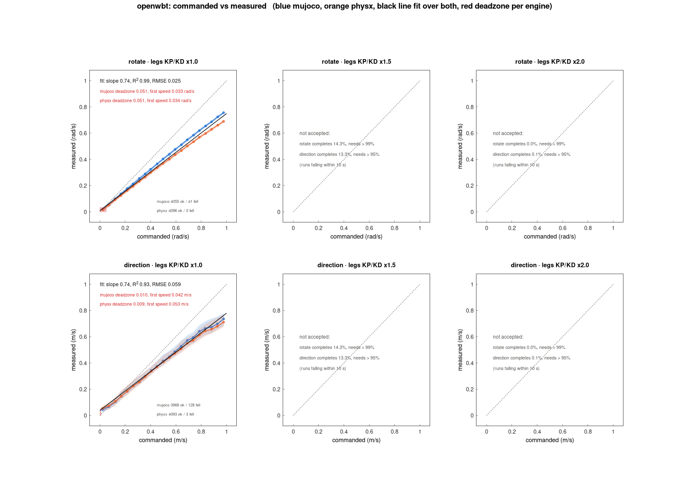

# teleop-walking-benchmark

https://github.com/user-attachments/assets/a1d2430a-24ee-4409-8cc1-43f4147a1c67

Thirty-four open-source Unitree G1 walking policies behind one C++ interface,
scored on one tour in MuJoCo and PhysX.
[Blog post](https://rhoyn.com/stable-walk?utm_source=github)

## The task

Ninety seconds, eighteen waypoints, 50 Hz control over a 2 ms step. A crane
holds a shared stance three seconds, then releases. Each segment lands a punch:
random joint and direction, 0.08 s, up to 500 N — the ceiling ramps from a
third of that at the start to the full 500 N by the sixtieth second, and each
punch draws half to all of it. The score is recovery, not tracking. A policy
owns the fifteen leg and waist joints; the fourteen arm joints random-walk under
the harness, never still, never borrowable for balance. The best finishes most
runs, none all.

## Unified benchmark interface

Every policy and every physics engine sits behind the same CUDA interface, so
the harness runs the whole field batched on the GPU instead of one process per
policy per run id. That is what makes 144,384 runs cheap enough to be a
benchmark rather than a demo. Both engines step on the GPU: PhysX natively,
MuJoCo through [MuJoCo Warp](https://github.com/google-deepmind/mujoco_warp).

## Running

```sh
./download_weights.sh && ./export_onnx.sh && make && make capture
./run.sh --policy gr00t_wbc_h074_p000 --engine physx --runids 0-255
./benchmark.sh          # whole field, both engines
```

Batches write `results/punches_gainx<G>/<tier>.r<NN>.<policy>.<engine>.csv`,
one folder per leg gain (1.0, 1.5, 2.0: the policy's leg kp and kd scaled);
`./build/table` renders the table, problems land in `benchmark.log`. Policies
are TensorRT plans cached in `build/trt/`.

MuJoCo Warp has no C API, so `make capture` records one substep as a CUDA graph
into `build/mjwarp/` and `--engine mujoco` replays it from C++ with no Python at
run time. It will not start without that capture, and the capture fixes the
fleet size — re-record when the model or `--runs` changes:
`make capture MJWARP_NWORLD=256`.

## Results

144,384 runs — both engines, in rounds of 512 run ids. A run id names one whole
task. A policy earns depth by tier: tier A, the eleven rows that complete at
least half their runs averaged over the two engines, ran ten rounds, 5120 run
ids; tier B ran one, since a policy that falls most of the time needs no fourth
decimal place. The `runs` column carries each row's own count, so no row is read
against a total it never had.

Rows are ordered by mean survival over both engines. Errors are means over
targets reached; the walk energy, vibration and stomp energy columns are means
over completed runs, and an engine's cell is blank when fewer than a fifth of
its runs qualify. Both engines step on the GPU: MuJoCo through MuJoCo Warp,
PhysX through its GPU solver.

Stomp energy is how hard a policy puts its feet down: the work a foot does
on the floor per touchdown, in joules — the ankle force integrated against
the foot's downward speed over each stance, every 2 ms substep, averaged over
the touchdowns of completed runs. Per-segment values are in each CSV as
`s<N>_stomp_j`.

| `--policy` | mean<br>survival<br>sec<br>mujoco<br>physx | completed<br>percent<br>mujoco<br>physx | runs | pos<br>err<br>cm<br>mujoco<br>physx | yaw<br>err<br>deg<br>mujoco<br>physx | walk<br>energy<br>KJ<br>mujoco<br>physx | walk<br>vibrations<br>mujoco<br>physx | stomp<br>energy<br>J<br>mujoco<br>physx |
|---:|---:|---:|---:|---:|---:|---:|---:|---:|
| `gr00t_wbc`<br>`h066_p012` | **84.9/82.2** | 80/69 | 5120 | 16/49 | 7/8 | 7.3/9.6 | 0.9/1.2 | 2.0/0.9 |
| `gr00t_wbc`<br>`h066_p000` | **84.7/81.8** | 79/67 | 5120 | 17/57 | 8/9 | 7.3/9.8 | 0.9/1.3 | 1.9/0.9 |
| `gr00t_wbc`<br>`h070_p000` | **83.3/82.9** | 73/71 | 5120 | 14/21 | 5/6 | 7.3/9.5 | 0.9/1.2 | 2.3/1.5 |
| `decoupled_wbc`<br>`h066_p000` | **83.9/81.3** | 74/67 | 5120 | 10/22 | 7/5 | 5.9/13.2 | 1.2/3.3 | 2.5/1.3 |
| `decoupled_wbc`<br>`h066_p012` | **83.9/80.9** | 75/66 | 5120 | 10/20 | 7/6 | 5.9/13.6 | 1.2/3.3 | 2.5/1.5 |
| `decoupled_wbc`<br>`h070_p000` | **83.1/80.2** | 72/63 | 5120 | 10/15 | 7/6 | 5.9/12.5 | 1.2/3.0 | 2.5/1.7 |
| `decoupled_wbc`<br>`h074_p000` | **82.3/80.1** | 69/62 | 5120 | 11/14 | 8/7 | 6.0/12.0 | 1.3/2.8 | 2.5/2.3 |
| `gr00t_wbc`<br>`h074_p000` | **80.1/80.0** | 63/61 | 5120 | 13/16 | 5/6 | 7.8/9.8 | 1.0/1.3 | 2.9/2.3 |
| `homie` | **78.2/77.4** | 55/52 | 5120 | 17/19 | 32/37 | 10.4/10.3 | 1.6/1.5 | 3.1/3.1 |
| `wbc_agile_velocity` | **75.1/79.3** | 49/60 | 5120 | 22/23 | 7/6 | 12.5/14.5 | 2.1/2.6 | 5.0/4.8 |
| `amo` | **75.7/77.6** | 53/57 | 5120 | 24/39 | 18/17 | 10.0/12.2 | 1.4/1.5 | 2.7/2.8 |
| `wbc_agile` | **70.9/64.3** | 33/18 | 512 | 23/41 | 8/11 | 7.7/- | 1.3/- | 3.3/- |
| `zealot` | **67.6/62.0** | 27/19 | 512 | 82/159 | 67/75 | 24.2/- | 10.8/- | 1.3/- |
| `sonic` | **68.5/52.9** | 36/11 | 512 | 30/44 | 9/11 | 11.5/- | 1.5/- | 3.4/- |
| `mimic_lite` | **48.1/59.5** | 9/21 | 512 | 76/89 | 12/12 | -/17.7 | -/2.3 | -/8.0 |
| `run_residual` | **51.7/48.1** | 8/5 | 512 | 589/586 | 13/14 | -/- | -/- | -/- |
| `asap` | **45.6/44.6** | 6/6 | 512 | 142/123 | 32/35 | -/- | -/- | -/- |
| `robomimic` | **45.1/42.5** | 7/7 | 512 | 193/179 | 15/17 | -/- | -/- | -/- |
| `falcon` | **36.8/35.8** | 1/1 | 512 | 42/50 | 14/18 | -/- | -/- | -/- |
| `wty_cpp` | **34.1/35.1** | 1/0 | 512 | 27/32 | 24/24 | -/- | -/- | -/- |
| `openwbt` | **26.8/40.6** | 0/0 | 512 | 82/73 | 48/50 | -/- | -/- | -/- |
| `schoi` | **31.5/28.8** | 0/1 | 512 | 48/81 | 38/45 | -/- | -/- | -/- |
| `rl_gym` | **19.7/37.7** | 0/0 | 512 | 120/78 | 28/16 | -/- | -/- | -/- |
| `rl_lab` | **25.4/22.1** | 0/0 | 512 | 57/71 | 73/74 | -/- | -/- | -/- |
| `handoff` | **21.3/22.8** | 0/0 | 512 | 148/149 | 24/23 | -/- | -/- | -/- |
| `bfm_zero` | **12.3/10.1** | 0/0 | 512 | 404/409 | 63/80 | -/- | -/- | -/- |
| `josabb`\* | **10.1/10.1** | 0/0 | 512 | 101/117 | 57/60 | -/- | -/- | -/- |
| `huru`\* | **7.8/8.0** | 0/0 | 512 | 150/145 | 58/63 | -/- | -/- | -/- |
| `sunny`\* | **7.3/7.9** | 0/0 | 512 | 152/164 | 63/67 | -/- | -/- | -/- |
| `holosoma` | **5.8/6.4** | 0/0 | 512 | 70/83 | 46/53 | -/- | -/- | -/- |
| `rl_mjlab` | **5.6/5.3** | 0/0 | 512 | 243/241 | 62/68 | -/- | -/- | -/- |
| `dm_march` | **6.4/4.0** | 0/0 | 512 | 147/162 | 92/90 | -/- | -/- | -/- |
| `dm_agile` | **5.2/3.4** | 1/0 | 512 | 57/52 | 88/87 | -/- | -/- | -/- |
| `legged_rl_lab` | **3.9/3.9** | 0/0 | 512 | 205/231 | 84/83 | -/- | -/- | -/- |
| `mturan33`\* | **2.8/4.3** | 0/0 | 512 | 223/212 | 87/88 | -/- | -/- | -/- |
| `wcompton` | **2.5/2.2** | 0/0 | 512 | 128/143 | 55/58 | -/- | -/- | -/- |
| `g1_gym` | **2.5/1.9** | 0/0 | 512 | 112/111 | 87/86 | -/- | -/- | -/- |
| `nanog1` | **2.1/2.2** | 0/0 | 512 | 82/91 | 58/61 | -/- | -/- | -/- |
| `stepdown` | **2.1/1.9** | 0/0 | 512 | 75/74 | 52/60 | -/- | -/- | -/- |
| `clobot` | **1.8/1.8** | 0/0 | 512 | 129/125 | 84/81 | -/- | -/- | -/- |
| ~~`handoff`<br>`with_arms`~~\*\* | ~~**70.1/69.7**~~ | ~~37/34~~ | ~~512~~ | ~~14/17~~ | ~~8/9~~ | ~~7.6/12.1~~ | ~~1.3/2.3~~ | ~~3.6/4.1~~ |
| ~~`clobot`<br>`with_arms`~~\*\* | ~~**43.6/36.3**~~ | ~~2/1~~ | ~~512~~ | ~~31/33~~ | ~~15/19~~ | ~~-/-~~ | ~~-/-~~ | ~~-/-~~ |

`gr00t_wbc` is HOMIE v2, not an independent policy family. Its author
developed it at GEAR as the successor to `homie`, with substantial
optimisations across the stack, so `gr00t_wbc` and `homie` are the same lineage
rather than separate entries. Confirmed by @Elgce in InternRobotics/OpenHomie#23.

\* Reads the base linear velocity straight from the simulator. No real robot
has that sensor, so the row is ranked but the policy is not deployable as
shipped.

\*\* Unranked, because it is the same policy given all 29 joints instead of 15.

`mimic_lite` is MimicLite-ROA driven by the SONIC planner: the released ROA
tracker follows reference motion that the harness has `sonic`'s planner
generate from the same velocity command, since mimic-lite ships no planner of
its own.

### Leg gains

Every policy was rerun with the kp and kd of its twelve leg joints scaled by
1.5 and by 2.0, waist and arms untouched, on 1024 run ids per engine:
`results/punches_gainx1.5/` and `results/punches_gainx2.0/` next to the
native-gain `results/punches_gainx1.0/` above. Compared over the run ids all
three share, 0-511 on both engines, stiffer legs make almost every policy
worse.

| `--policy` | mean survival sec<br>x1.0 / x1.5 / x2.0 | x1.5<br>diff | x2.0<br>diff | walk energy KJ<br>x1.0 / x1.5 / x2.0 | walk vibrations<br>x1.0 / x1.5 / x2.0 |
|---:|---:|---:|---:|---:|---:|
| `openwbt` | 33.7 / 4.9 / 2.5 | -85.4% | -92.5% | - / - / - | - / - / - |
| `rl_gym` | 28.7 / 8.9 / 4.1 | -69.0% | -85.6% | - / - / - | - / - / - |
| `schoi` | 30.2 / 14.1 / 3.7 | -53.2% | -87.9% | - / - / - | - / - / - |
| `rl_lab` | 23.8 / 15.6 / 10.7 | -34.2% | -54.8% | - / - / - | - / - / - |
| `wbc_agile` | 67.6 / 53.5 / 28.8 | -20.8% | -57.4% | 8.3 / - / - | 1.4 / - / - |
| `wty_cpp` | 34.6 / 29.0 / 17.1 | -16.1% | -50.5% | - / - / - | - / - / - |
| `sonic` | 60.7 / 49.2 / 34.0 | -19.0% | -44.0% | 14.0 / - / - | 1.7 / - / - |
| `wbc_agile_velocity` | 77.6 / 67.1 / 44.1 | -13.5% | -43.1% | 13.7 / 25.0 / - | 2.4 / 3.6 / - |
| `handoff`<br>`with_arms` | 69.9 / 64.3 / 37.7 | -8.0% | -46.1% | 9.8 / 14.4 / - | 1.8 / 2.2 / - |
| `legged_rl_lab` | 3.9 / 3.3 / 2.9 | -16.5% | -25.3% | - / - / - | - / - / - |
| `falcon` | 36.3 / 34.5 / 23.1 | -5.1% | -36.4% | - / - / - | - / - / - |
| `asap` | 45.1 / 41.9 / 31.0 | -7.2% | -31.2% | - / - / - | - / - / - |
| `run_residual` | 49.9 / 49.3 / 35.6 | -1.1% | -28.7% | - / - / - | - / - / - |
| `robomimic` | 43.8 / 39.4 / 35.5 | -10.1% | -19.0% | - / - / - | - / - / - |
| `handoff` | 22.1 / 22.3 / 15.7 | +1.1% | -28.7% | - / - / - | - / - / - |
| `mturan33` | 3.5 / 3.2 / 3.1 | -9.2% | -13.6% | - / - / - | - / - / - |
| `decoupled_wbc`<br>`h074_p000` | 81.5 / 78.3 / 68.7 | -3.9% | -15.7% | 9.1 / 11.3 / 20.6 | 2.0 / 2.4 / 3.9 |
| `g1_gym` | 2.2 / 2.1 / 1.9 | -5.7% | -13.0% | - / - / - | - / - / - |
| `decoupled_wbc`<br>`h070_p000` | 82.0 / 78.9 / 70.8 | -3.7% | -13.7% | 9.1 / 13.0 / 22.5 | 2.1 / 2.6 / 4.2 |
| `gr00t_wbc`<br>`h070_p000` | 82.9 / 79.9 / 74.5 | -3.6% | -10.1% | 8.4 / 12.9 / 21.9 | 1.1 / 1.5 / 2.4 |
| `decoupled_wbc`<br>`h066_p012` | 82.7 / 80.3 / 74.5 | -3.0% | -10.0% | 9.5 / 13.8 / 20.4 | 2.2 / 2.8 / 3.8 |
| `homie` | 77.3 / 75.4 / 71.0 | -2.4% | -8.1% | 10.3 / 15.1 / 23.2 | 1.5 / 1.8 / 2.4 |
| `rl_mjlab` | 5.4 / 5.5 / 4.9 | +0.2% | -10.2% | - / - / - | - / - / - |
| `gr00t_wbc`<br>`h074_p000` | 80.3 / 79.3 / 74.0 | -1.3% | -7.9% | 8.8 / 12.9 / 22.0 | 1.1 / 1.5 / 2.4 |
| `gr00t_wbc`<br>`h066_p012` | 83.9 / 83.6 / 76.5 | -0.3% | -8.8% | 8.4 / 12.4 / 21.1 | 1.0 / 1.4 / 2.2 |
| `gr00t_wbc`<br>`h066_p000` | 83.5 / 82.9 / 76.6 | -0.7% | -8.2% | 8.4 / 12.2 / 20.7 | 1.0 / 1.4 / 2.2 |
| `bfm_zero` | 11.2 / 11.7 / 9.9 | +4.4% | -11.4% | - / - / - | - / - / - |
| `decoupled_wbc`<br>`h066_p000` | 82.5 / 81.4 / 77.8 | -1.3% | -5.6% | 9.4 / 11.8 / 19.5 | 2.2 / 2.5 / 3.7 |
| `wcompton` | 2.4 / 2.4 / 2.2 | +1.4% | -8.1% | - / - / - | - / - / - |
| `amo` | 77.2 / 78.6 / 79.5 | +1.8% | +3.0% | 11.0 / 13.8 / 17.7 | 1.4 / 1.6 / 1.9 |
| `zealot` | 64.8 / 72.1 / 64.6 | +11.3% | -0.4% | 24.1 / 62.0 / 101.4 | 9.0 / 14.4 / 18.4 |
| `mimic_lite` | 53.8 / 56.5 / 57.0 | +5.0% | +6.0% | - / - / 26.8 | - / - / 3.1 |
| `holosoma` | 6.1 / 6.6 / 6.4 | +7.8% | +4.7% | - / - / - | - / - / - |
| `clobot` | 1.8 / 1.9 / 1.9 | +5.8% | +7.0% | - / - / - | - / - / - |
| `clobot`<br>`with_arms` | 39.9 / 43.3 / 42.6 | +8.4% | +6.7% | - / - / - | - / - / - |
| `huru` | 7.9 / 9.7 / 9.9 | +23.3% | +25.7% | - / - / - | - / - / - |
| `dm_agile` | 4.3 / 4.9 / 5.9 | +13.2% | +37.5% | - / - / - | - / - / - |
| `nanog1` | 2.2 / 2.7 / 2.9 | +26.0% | +33.5% | - / - / - | - / - / - |
| `josabb` | 10.1 / 13.0 / 13.9 | +29.0% | +38.1% | - / - / - | - / - / - |
| `dm_march` | 5.2 / 7.4 / 6.6 | +42.5% | +27.3% | - / - / - | - / - / - |
| `sunny` | 7.6 / 9.9 / 11.2 | +29.8% | +47.9% | - / - / - | - / - / - |
| `stepdown` | 2.0 / 4.0 / 4.1 | +101.7% | +109.9% | - / - / - | - / - / - |

Energy and vibrations are means over completed runs of both engines, `-`
where fewer than a fifth of a row's runs complete.

Stiffer legs cost the leaders up to four percent of their survival at x1.5 and
six to sixteen percent at x2.0, while `openwbt`, `rl_gym` and `schoi` lose most
of theirs already at x1.5. Only `amo`, `zealot`, `mimic_lite` and `clobot` with
arms gain among the rows that last half a minute or more; the large gains at
the bottom of the table are a few seconds on policies that fall within the
first quarter-minute either way. Each network learned the dynamics of the gains
it was trained with, so scaling them moves most policies outside what they
know, and the legs also work harder for it: every row that completes enough
runs spends more energy and vibrates more, `gr00t_wbc` h066_p012 going from 8.4
to 12.4 to 21.1 kJ.

TL;DR: increasing the default leg gains makes most policies less stable.

### Why two policies appear four times each

`gr00t_wbc` and `decoupled_wbc` are each one checkpoint under four commanded
postures: `h` is torso height in metres, `p` torso pitch in radians. Every row
owns the same fifteen joints and takes the same commands as any other entry, so
every row is ranked. `gr00t_wbc_h074_p000` and `decoupled_wbc_h070_p000` are
the postures their authors call canonical.

Commanded height is the only thing that moves the score, and for `gr00t_wbc` it
buys completion by giving up tracking: 0.74 → 0.70 m is worth ten points of
completion in either engine for one and five centimetres of position error;
0.66 m is another seven points in MuJoCo for two more centimetres, while in
PhysX it gives two to four points back and the error more than doubles,
21 → 49-57 cm. `decoupled_wbc` pays far less — 0.70 → 0.66 m gains two to four
points, and its position error holds at 10 cm in MuJoCo, the lowest in the
table, though PhysX drifts from 15 to 20-22 cm. Commanded pitch does nothing
for completion in either.

A wider sweep over `gr00t_wbc`'s walk/balance switch found it inert, so it is
not reported. Read every one of these rows against the error column as well as
the completion column.

The `decoupled_wbc` sweep was suggested by @chrisyrniu in
https://github.com/chrisyrniu/IsaacLab-Decoupled-WBC/issues/1#issuecomment-5596278961

### What a low score means

This benchmark scores a **walking policy that controls the lower body while the
upper body is driven externally**. The 15 leg and waist joints belong to the
policy; the 14 arm joints random-walk under the harness for the whole run.

Several policies score badly because they were trained to swing their arms to
keep balance, and that is not available to them here — the arms are assumed to
belong to a separate policy. **A low score is therefore not always a statement
that the policy is bad.** It often means the policy was never built for
lower-body balance under external upper-body control.

## Commanded vs measured movement

<!-- cmd_vs_real_movements:begin -->
Each run holds one command for 10 s, with no punches: a yaw rate in `--mode rotate`, a planar velocity in `--mode direction`, both drawn uniformly per run id up to 1 rad/s and 1 m/s. `./benchmark.sh --benchmark rotate|direction` runs every policy at legs KP/KD x1.0, x1.5 and x2.0 for 4096 run ids each into `results/<mode>_gainx<G>/`, and `build/cmd_vs_real_movements` charts measured against commanded speed into `results/cmd_vs_real_movements/`. Linear real vs commanded is R^2 of the line fitted to measured vs commanded with both engines pooled, the share of the measured speed's variance the line explains, higher is better; deadzone is the command needed to reach a measured 0.025, averaged over both engines. Policies are listed when their legs KP/KD x1.0 runs complete > 95% on average and at least one gain completes > 99% in rotate and > 95% in direction; values are at the first such gain, and the order sums each column's rank, 1 = lowest.

| # | policy | legs<br>KP/KD | linear<br>real<br>vs<br>commanded<br>walk<br>speed | linear<br>real<br>vs<br>commanded<br>rotation<br>speed | walk<br>speed<br>deadzone | rotation<br>speed<br>deadzone |
|---:|---|---:|---:|---:|---:|---:|
| 0 | [`openwbt`](results/cmd_vs_real_movements/000_openwbt.png) | x1.0 | 93% | 99% | 0.0095 | 0.0505 |
| 1 | [`gr00t_wbc_h074_p000`](results/cmd_vs_real_movements/001_gr00t_wbc_h074_p000.png) | x1.0 | 89% | 96% | 0.0530 | 0.0505 |
| 2 | [`falcon`](results/cmd_vs_real_movements/002_falcon.png) | x1.0 | 61% | 98% | 0.0094 | 0.0402 |
| 3 | [`handoff_with_arms`](results/cmd_vs_real_movements/003_handoff_with_arms.png) | x1.0 | 94% | 98% | 0.1108 | 0.1100 |
| 4 | [`gr00t_wbc_h070_p000`](results/cmd_vs_real_movements/004_gr00t_wbc_h070_p000.png) | x1.0 | 79% | 95% | 0.0530 | 0.0710 |
| 5 | [`mimic_lite`](results/cmd_vs_real_movements/005_mimic_lite.png) | x1.0 | 94% | 91% | 0.1617 | 0.0510 |
| 6 | [`wbc_agile_velocity`](results/cmd_vs_real_movements/006_wbc_agile_velocity.png) | x1.0 | 86% | 100% | 0.1517 | 0.0926 |
| 7 | [`gr00t_wbc_h066_p000`](results/cmd_vs_real_movements/007_gr00t_wbc_h066_p000.png) | x1.5 | 81% | 90% | 0.0621 | 0.0818 |
| 8 | [`gr00t_wbc_h066_p012`](results/cmd_vs_real_movements/008_gr00t_wbc_h066_p012.png) | x1.5 | 80% | 91% | 0.0621 | 0.0818 |
| 9 | [`asap`](results/cmd_vs_real_movements/009_asap.png) | x1.0 | 50% | 77% | 0.0094 | 0.0094 |
| 10 | [`amo`](results/cmd_vs_real_movements/010_amo.png) | x1.0 | 88% | 86% | 0.1108 | 0.0710 |
| 11 | [`decoupled_wbc_h066_p012`](results/cmd_vs_real_movements/011_decoupled_wbc_h066_p012.png) | x1.0 | 92% | 89% | 0.1000 | 0.1794 |
| 12 | [`wbc_agile`](results/cmd_vs_real_movements/012_wbc_agile.png) | x1.0 | 97% | 86% | 0.1204 | 0.2908 |
| 13 | [`zealot`](results/cmd_vs_real_movements/013_zealot.png) | x1.0 | 91% | 89% | 0.1108 | 0.1600 |
| 14 | [`decoupled_wbc_h066_p000`](results/cmd_vs_real_movements/014_decoupled_wbc_h066_p000.png) | x1.0 | 90% | 88% | 0.1000 | 0.1794 |
| 15 | [`clobot_with_arms`](results/cmd_vs_real_movements/015_clobot_with_arms.png) | x1.0 | 71% | 98% | 0.1408 | 0.1328 |
| 16 | [`sonic`](results/cmd_vs_real_movements/016_sonic.png) | x1.0 | 89% | 93% | 0.1709 | 0.1305 |
| 17 | [`decoupled_wbc_h070_p000`](results/cmd_vs_real_movements/017_decoupled_wbc_h070_p000.png) | x1.0 | 96% | 84% | 0.1309 | 0.2514 |
| 18 | [`robomimic`](results/cmd_vs_real_movements/018_robomimic.png) | x1.0 | 78% | 96% | 0.1810 | 0.1599 |
| 19 | [`homie`](results/cmd_vs_real_movements/019_homie.png) | x1.0 | 96% | 74% | 0.1810 | 0.6303 |
| 20 | [`decoupled_wbc_h074_p000`](results/cmd_vs_real_movements/020_decoupled_wbc_h074_p000.png) | x1.0 | 95% | 65% | 0.1810 | 0.4111 |
| 21 | [`rl_lab`](results/cmd_vs_real_movements/021_rl_lab.png) | x1.0 | 84% | 45% | 0.1602 | 0.4595 |



`openwbt` ranks first at legs KP/KD x1.0. Its measured speed follows a straight line through the command in both benchmarks, R² 93% walking and 99% turning, and it starts moving almost at once, with deadzones of 0.010 m/s and 0.051 rad/s. The line is not y = x: it walks and turns at about 74% and 74% of the command, a constant gain a teleop mapping can scale away. In the punch tour above it survives 33.7 s on average, 23 of 42 (the best, `gr00t_wbc_h066_p012`, 83.6 s), so it is not the policy that stays up best under punches; it is the one whose speed follows the walking and rotation commands most cleanly.

MuJoCo and PhysX differ in yaw-rate tracking by 0.049 on average (area between the engines' median curves at x1.0), from `amo` closest to `decoupled_wbc_h066_p000` furthest; per policy in [results/cmd_vs_real_movements/README.md](results/cmd_vs_real_movements/README.md).
<!-- cmd_vs_real_movements:end -->

Run id 0 of each benchmark on every policy above, in rank order, PhysX and
MuJoCo side by side (`./preview.sh --benchmark rotate|direction`).

Rotate, turning right at 0.1 rad/s:

https://github.com/user-attachments/assets/1ea27fb6-a9cf-4c89-8791-99e545b0c1fc

Direction, walking straight ahead at 0.1 m/s:

https://github.com/user-attachments/assets/938add24-a596-461c-bdfb-2fbac219c5be

## MuJoCo vs Isaac Sim engine: PhysX

Each row is one policy run twice — the same exported weights, the same
waypoints, the same punches — stepped by two different physics engines. Nothing
about the policy changes between the two halves of `completed`; only the
contact model does.

They disagree because contact is solved differently: MuJoCo integrates soft
convex constraints, PhysX runs a TGS solver over rigid contact patches, and
neither is the real robot. A policy that scores in one engine has learned that
engine's contacts; one that scores in both survives a change of contact model
it never saw in training, which is the best proxy here for sim-to-real
transfer. Read the two numbers together, not separately.

Neither engine repeats a run id bit for bit: both step on the GPU and reduce
contact forces across threads in arbitrary order, so the same run id can pass
one round and fall the next. Compare aggregates across rounds, not individual
run ids.

## Weights

Third-party; terms in [NOTICE](NOTICE) — two non-commercial, eleven silent,
one sim-only. Nineteen weight files committed, the rest fetched or converted
locally, since a licence travels to its conversion.
